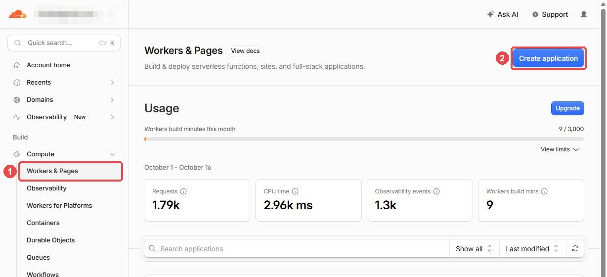
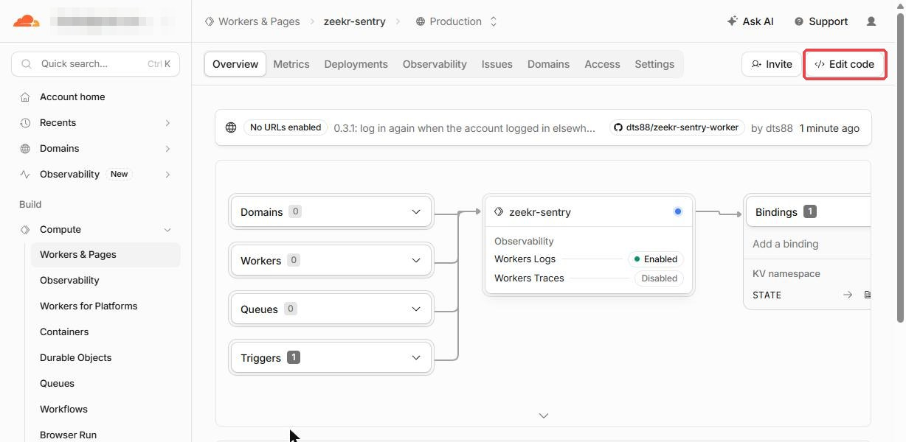
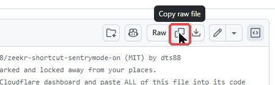
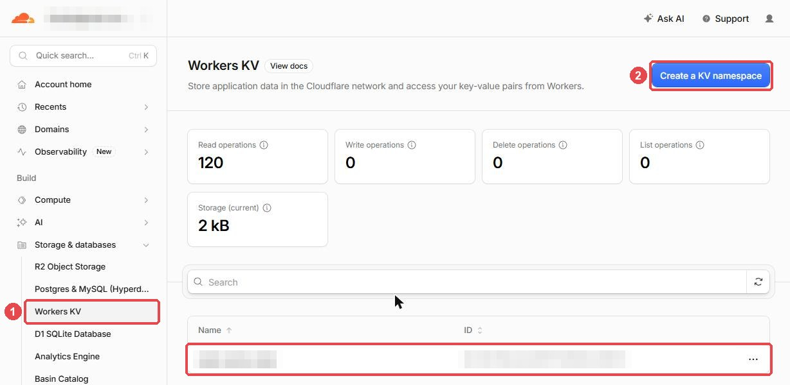
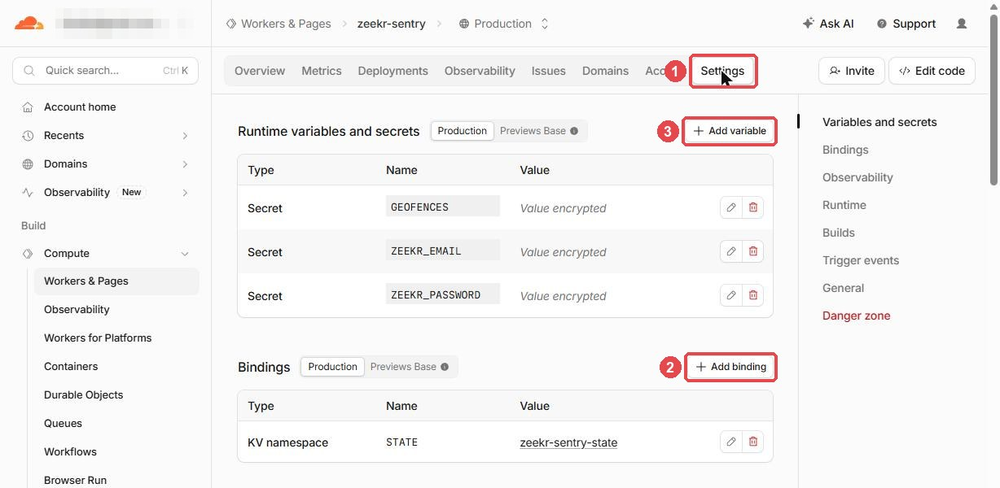
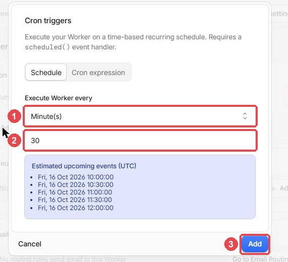
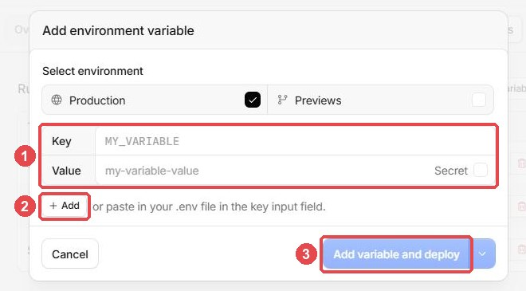
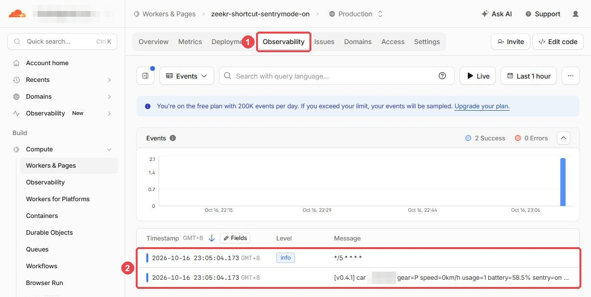
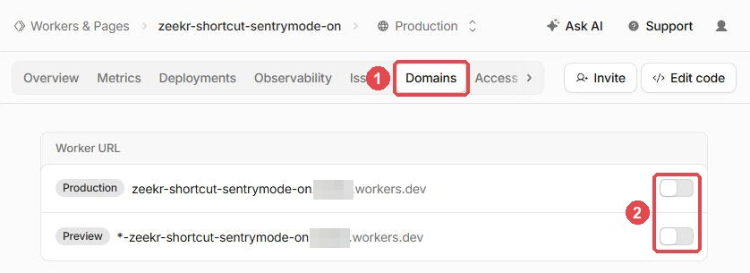

# Setup with a Cloudflare account only (no GitHub)

For when you don't have a GitHub account: create a Worker in the Cloudflare dashboard, paste the program in, and set a
few things by hand. The result is the same as the [setup with GitHub](../README.md#set-up-step-by-step): it checks
your car every 5 minutes.

If you have a GitHub account, the setup with GitHub has fewer steps, and upgrading there is one click.

**Before you start,** prepare the second Zeekr account and your places as described in
[Before you start](../README.md#before-you-start-four-things-to-prepare) (you can skip the GitHub account).
**Install it only once:** two copies signing in to the same Zeekr account keep signing each other out.

Cloudflare sometimes rewords its pages, so what you see may differ slightly from the pictures below.

## Step 1: Create a Worker

In the Cloudflare dashboard, open **Compute** → **Workers & Pages** and click **Create application**.

On the next page choose **Start with Hello World!**, name the Worker `zeekr-shortcut-sentrymode-on`, then click
**Deploy**. Don't choose **Upload your static files**: that is for static websites, and the program would not run.

## Step 2: Paste the program in

1. On the Worker's page, click **Edit code** (top right). Delete everything in the editor.

   

2. Open https://github.com/dts88/zeekr-shortcut-sentrymode-on/blob/main/dist/zeekr-sentry.js and click the
   **Copy raw file** button next to **Raw**. This copies the whole program.

   

3. Paste it into the editor and click **Deploy**.

Now open the Worker's address (the `...workers.dev` address on the Worker's page). It shows the version and a list of
the settings that are still missing, which means the program is running.

## Step 3: Create the storage space and connect it

1. In the left menu, open **Storage & databases** → **Workers KV** and click **Create a KV namespace**. Name it
   `zeekr-sentry-state` and create it. (Not `zeekr-shortcut-sentrymode-on-state`: the setup with GitHub creates a
   storage space with that name, and fails if one already exists.)

   

2. Back on the Worker's page, open **Settings**. Under **Bindings**, click **Add binding** and choose
   **KV namespace**.
3. **Variable name must be `STATE`** (capital letters, no spaces). For the KV namespace, choose the one you just
   created. Add the binding.

   

## Step 4: Schedule it

On the Worker's **Settings** page, under **Trigger events** → **Cron triggers**, click **+ Add**. On the **Schedule**
tab, set *Execute Worker every* to **Minute(s)** and change the number to **5** (it starts at 30), then click **Add**.
A new schedule can take up to 15 minutes to start.

## Step 5: Add the three settings

On the Worker's **Settings** page, under **Runtime variables and secrets**, click **+ Add variable** (3 in the Step 3
picture). Fill in a row for each of the three settings: the name in **Key**, the value in **Value**, and tick
**Secret** where the table says so; **+ Add** gives you the next row. Then click **Add variable and deploy**.

| Key | Value | Secret |
|---|---|---|
| `ZEEKR_EMAIL` | the second account's email address | don't tick |
| `ZEEKR_PASSWORD` | the second account's password | **always tick it** |
| `GEOFENCES` | your places, for example `Home, 1.3521, 103.8198, 600` | don't tick |

## Step 6: Check that it runs

- Reload the Worker's address. It should say `Setup is complete`; anything still missing is listed there.
- Open the Worker's **Observability** tab. After the next scheduled run you should see `logging in`,
  `logged in (... account, region ...)` and a line about the car. If nothing ever appears, check that **Logs** is
  switched on under **Settings** → **Observability**.

  

Anyone can open the Worker's address, but it only shows the version, the credits and the names of the settings, never
your email, password or places. Still, once it says `Setup is complete`, switch it off (Step 7).

## Step 7: Switch off the Worker's address

The address is only for the check in Step 6. Open the Worker's **Domains** tab (1) and, under **Worker URL**, switch
off **Production** and **Preview** (2). The schedule keeps running; only the address stops answering. To use the
check again later, switch **Production** back on for a moment.

## After that

Reading the log, changing settings, pausing, uninstalling and the FAQ are the same as for the setup with GitHub: see
[Everyday use](../README.md#everyday-use) and [FAQ](../README.md#faq). Two differences:

- **Uninstalling:** the storage space to delete is `zeekr-sentry-state`; there is no fork to delete, and no GitHub
  access to take back.
- **Upgrading:** when the log says `version … is available …`, copy the new version of the file as in step 2, replace
  everything in **Edit code** and click **Deploy**. Your settings stay as they are.
